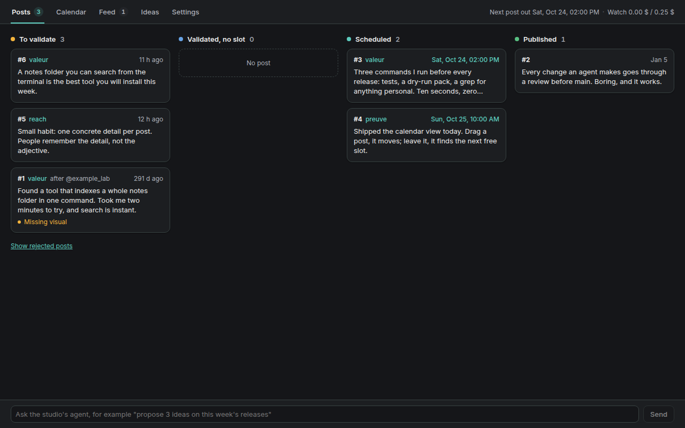

# Growth Studio

A Timon plugin to write, validate, schedule and publish social posts with an agent of your choice: queue of drafts,
validation, automatic scheduling, calendar, triage of watched content, and publishing at the planned time.

Nothing is ever published without your validation: a post goes out only once you validated it in the studio
(`validated_by`), with a visual unless you ticked "Publish without a visual", and never naming a competitor listed in
the database.

| | |
| --- | --- |
| Manifest id | `growth-studio` (never changes: data, settings and backups are keyed by it) |
| Kinds | `island` (studio tab, `growth-studio:studio`), `page` (route `/growth`), `widget` (cockpit card) |
| Minimum Timon plugin API | 10 (shipped skills, agent management) |
| Runtime | the Node.js that runs Timon, 22.5 or newer (`node:sqlite`) |
| Licence | MIT, see `LICENSE` |



## Install

```bash
timon plugin add ./timon-ai-growth-studio-<version>.tgz
timon plugin list          # growth-studio must show as active
```

The command prints the permissions below and asks for confirmation. A package that is not signed by the distributor
loads only where developer mode is open (a valid Timon licence and `developer.unsignedPlugins: true`). Then open the
**Growth Studio** page (`/growth`) or add its tab to an island: a blank studio opens on the Set up screen.

Installing a newer archive over an installed one keeps every piece of data (see "Data, upgrades and backups").

**Coming from a package with another npm name** (`growth-studio` before 0.2.0-rc.3, or a local folder install):
the two packages claim the same id, so the newer one would load and the older one stay installed as
`skipped:duplicate-id`. Remove the old package **before** adding the new archive; the data is kept:

```bash
timon plugin remove growth-studio                         # the only package with this id at that point
timon plugin add ./timon-ai-growth-studio-<version>.tgz
```

If both are already installed, `timon plugin remove growth-studio` removes the first one found (the new one): run it
until neither is listed, then add the new archive again.

## Permissions, and why each one is requested

| Permission | Used for |
| --- | --- |
| `settings` | reading the plugin settings below (agent, connectors, jobs) |
| `storage` | its own folder: the SQLite database, media files, backups and the agent tools' exchange folder; its key-value store (agent check, agents granted to each user, schema version of each installed version) |
| `notify` | a report when a post is published; an alert when a publication fails, a provider refuses a key (401) or a mission cannot start |
| `secrets:read` | the vault secrets whose **names** you set: GetXAPI key, x.com session cookie of each account, treg API key. Never a fixed name, never shown back |
| `http:outbound` | GetXAPI (bookmarks, media upload, quotes) and treg in http mode. Also needs `pluginPolicy.http.allow` |
| `host:exec` | the `treg` CLI (publishing, watch) and a headless Chrome (coded visuals). Also needs `pluginPolicy.exec.allow` |
| `missions:spawn` | missions of the studio's agent: drafts, rewrites, visuals, triage, news, original ideas, accepted rules, the Set up test. Also needs `pluginPolicy.spawn.approved` |
| `realtime:publish` | refreshing the open studio tabs of the user whose data changed |
| `skills:write` | installing its two skills, `growth-studio-tools` (the agent's commands) and `growth-studio-setup` |
| `agents:manage` | creating the studio's agent from the Set up screen, and listing the agents a user may choose for an organization or an account. Without it you pick an existing agent, and only the plugin's agent runs the missions |
| `backends:read` | Timon's backend catalogue: provider and model choices when creating the agent, and whether the realistic image engine (Codex) is available |

`missions:spawn`, `host:exec` and `http:outbound` are refused by Timon until the operator allows them in
`pluginPolicy` (see "Optional connectors"). The plugin never edits `timon.config.json`.

## Plugin settings

Set in Timon's plugin settings (Plugins › Growth Studio). Everything editorial (voice, rules, instructions, schedule,
sources) is set inside the studio instead, per user, organization and account.

| Setting | Default | What it does |
| --- | --- | --- |
| `agent` | empty | the Timon agent that writes for the studio. Required: no mission starts until it is set (the Set up sets it). It is the default: an organization, an account or a user can choose another one in the studio (see "One agent per organization") |
| `agentNode` | empty | command the agent runs the studio tools with; empty = the runtime running Timon (see "Known limits") |
| `bookmarksJob` | off | fetch X bookmarks in the plugin (see "Background jobs") |
| `watchJob` | off | poll watched accounts in the plugin |
| `synthesisJob` | off | weekly synthesis of the feedback into rule proposals |
| `commentsJob` | off | search posts for the prospecting comment campaigns, then qualification missions |
| `tregMode` | `cli` | `cli` (the `treg` command and its `treg login` session) or `http` (treg API with a key) |
| `tregBaseUrl` | `https://treg.to` | treg API address in http mode |
| `tregToken` / `tregTokenSecret` | empty | treg key typed here, or the name of the vault secret holding it (http mode) |
| `getxapiKey` / `getxapiKeySecret` | empty / `GETXAPI_KEY` | GetXAPI key typed here, or the name of the vault secret holding it |
| `chromeBinary` | empty | headless browser for coded visuals (name or absolute path); empty = the first allowed of `google-chrome`, `google-chrome-stable`, `chromium`, `chromium-browser`, `chrome`, `msedge` |
| `rulesToMemory` | off | also record an accepted (or automatically applied) rule for all accounts in the agent's Timon memory |
| `backupsToKeep` | 5 | database backups kept before each migration |
| `dataSource` / `legacyDbPath` | `plugin` / empty | transition only: serve an existing project database in place instead of the plugin's own (see "Import an existing database") |

## First launch: Set up

A blank studio (no agent chosen, or no managed account yet) opens on the **Set up** screen instead of the usual views.
It stays reachable afterwards from Settings › Set up. Six steps, the first two required:

1. **The agent** that writes for the studio: choose one of your Timon agents, or create one (`agents:manage`; the
   provider and model come from Timon's backend catalogue, never from a fixed list; the agent gets a neutral
   instruction and the `research` role). Without the right to create agents, the screen explains how to create one
   on the Agents page. Then **Check the agent**: a short mission runs the tools' `ping` command, which proves that the
   agent can run Node.js 22.5 or newer and reach the studio from its sandbox. When it cannot (typically the desktop
   app, where Timon runs inside its own runtime and `node` may be missing), the screen says what to do: install
   Node.js 22.5+, set the plugin setting `agentNode` (`node`, or an absolute path), check again.
2. **The accounts**: the organization and the first account (network, handle, language, role).
3. **The writing**: voice guide and instructions. "Use the generic defaults" fills only what is empty (voice guide,
   rules, post types, original-idea instructions, triage criteria); "Write them with the agent" opens a conversation.
4. **Connectors** (optional): each connector's state, the exact `pluginPolicy` lines and the commands that create
   and grant its secrets. The plugin never edits `timon.config.json`: you add the block and restart Timon.
5. **Import** (optional, administrator): an existing `growth.db` (see "Data" below).
6. **The test**: the agent writes one short draft, which stays to validate. Nothing is published.

**Set up with the agent** starts the same path as a conversation: a mission with the `growth-studio-setup` skill
(installed by the plugin with `growth-studio-tools`), which uses the CLI's `setup …` commands (`setup status`,
`setup org`, `setup account`, `setup starter`, `setup set`, `setup keys`) and ends with the same test draft.

## Optional connectors

Every external provider sits behind a connector (`lib/connectors/`). A connector that is missing disables its own
feature with a clear message; the rest of the studio keeps working. Checks run when a feature is used, never at
install, and never call the network (every provider endpoint below is paid).

| Connector | Runs | Features | `pluginPolicy` entry | Credentials (settings) | Unit costs |
| --- | --- | --- | --- | --- | --- |
| treg | host, `treg` CLI (default) or treg API over HTTP | publishing ordinary posts on X, watch of followed accounts, `item add` (one X post to quote) | `exec.allow: ["treg"]` (cli) or `http.allow: ["treg.to"]` (http) | cli: your `treg login` session. http: `tregToken` (typed) or `tregTokenSecret` (vault secret name), `tregBaseUrl` | watch ≈ $0.00045 per page of ~20 posts ($0.0006 in search mode); `item add` ≈ $0.00075 per post (counted in the daily watch budget); publish $0.015 per post or prospecting reply, $0.20 if the text holds a URL (billed by X) |
| GetXAPI | host, `ctx.fetch` | X bookmarks, media upload, quotes | `http.allow: ["api.getxapi.com"]` | `getxapiKey` (typed) or `getxapiKeySecret` (vault secret name, default `GETXAPI_KEY`); per account: `getxapi_token_secret` (vault secret holding that account's x.com session cookie) | $0.001 per bookmarks page, $0.001 per media upload, $0.002 per quote |
| GPT Image (Codex) | a mission of your agent | realistic visuals | none | your Codex subscription | included in the subscription |
| Headless Chrome | host, `chromeBinary` (empty = `google-chrome`, `chromium`… whichever is allowed) | renders the HTML of a "chart or diagram" visual to a 1200×675 PNG | `exec.allow: ["google-chrome"]` (or the name / absolute path you set) | none | free |

Notes:

- `ctx.host.exec` never passes Timon's vault to a command, so the treg CLI uses the session of the user running
  Timon. To use a dedicated treg key instead, set `tregMode` to `http` and give the key.
- A plugin can never run the Codex CLI. Realistic images are made by a mission of your agent with its own tools, then
  attached with the `attach-media` tool. The engine is hidden when Timon's backend catalogue shows no connected Codex
  backend, and shown with a note when that cannot be known.
- Without a browser the plugin may run, the agent renders the HTML page itself.
- Vault secrets are granted to the plugin with `timon secret grant <NAME> --scope agent:plugin:growth-studio`.
- `missions:spawn` also needs `pluginPolicy.spawn.approved: ["growth-studio"]`.

Example `pluginPolicy` (in `timon.config.json`, read at startup: restart Timon after a change):

```json
{
  "pluginPolicy": {
    "spawn": { "approved": ["growth-studio"] },
    "exec": { "allow": ["treg", "google-chrome"] },
    "http": { "allow": ["api.getxapi.com"] }
  }
}
```

External pieces, in one place:

| Kind | Name | Needed by | Operator entry |
| --- | --- | --- | --- |
| binary | `treg` | publishing on X, watch (cli mode) | `pluginPolicy.exec.allow: ["treg"]` |
| binary | `google-chrome` (or `chromium`, `msedge`, an absolute path) | coded visuals | `pluginPolicy.exec.allow` |
| domain | `api.getxapi.com` | bookmarks, media upload, quotes | `pluginPolicy.http.allow` |
| domain | `treg.to` (or your `tregBaseUrl` host) | treg http mode only | `pluginPolicy.http.allow` |
| secret | GetXAPI key (name in `getxapiKeySecret`) | bookmarks, media, quotes | `timon secret grant <NAME> --scope agent:plugin:growth-studio` |
| secret | x.com session cookie, one per X account (name in the account's Publishing tab) | bookmarks, media upload | same |
| secret | treg API key (name in `tregTokenSecret`) | treg http mode only | same |
| policy | missions | every agent feature | `pluginPolicy.spawn.approved: ["growth-studio"]` |

Without any of them the studio still opens, keeps its data, validates and schedules posts; each missing piece only
disables its own feature, with a message saying what to add.

## Background jobs

Four jobs run in the plugin (three of them replace scheduled scripts and routines). Each has a switch in the plugin settings, **off by default**: turn it on only
once no other tool does the same work, or the same content is fetched (and paid) twice.

- **X bookmarks** (`bookmarksJob`): for each managed X account whose "bookmarks" source is on and whose x.com cookie
  secret is set, fetches the first page of bookmarks when due (`bookmarks_poll_interval_min`, 0 = stopped; window
  `bookmarks_window_start` / `_end` in the publishing time zone), keeps only the new ones and starts one triage
  mission at a time (started again after 30 minutes if bookmarks are still waiting). The triage criteria are the
  account's "Bookmark triage criteria" setting: without them no triage starts. GetXAPI refusing the access (401)
  raises one alert until the next successful fetch.
- **Watch of followed accounts** (`watchJob`): polls the watched accounts that have a priority (`breaking`, `daily`,
  `weekly`; their own interval and active hours) through treg. The first poll of an account is a baseline. Spending
  stops at the daily budget (`daily_budget_usd`). A new post of a `breaking` account becomes a news item; once the
  thread is quiet (`news_quiet_minutes`), one mission drafts it for the managed accounts whose "news" source is on,
  at most `news_max_tasks_per_day` a day. Over that cap, with no target account, or when the mission cannot start, the
  items are set aside with a note: there is no automatic new attempt. treg refusing the key (401) stops polling and
  raises one alert.

- **Weekly synthesis of the feedback** (`synthesisJob`): once a week (`synthesis_weekday`, 0 = Sunday, default 0;
  `synthesis_hour`, default 19, in the publishing time zone), for each user with feedback not synthesized yet, one
  mission reads it (`feedback pending`) and proposes rules (`feedback propose`). By default the studio applies a proposed rule at once (user setting
  `rules_auto_accept`, Settings › Learning); the user can revoke any applied rule there, and a revoked rule is never
  proposed again. With the setting off, the user accepts or refuses each proposal; the mission itself never installs a rule. Switched on after a slot has passed, it waits
  for the next one.

- **Prospecting comments** (`commentsJob`): for each active comment campaign, when due (`comments_poll_interval_min`,
  default 60, 0 = stopped; window `comments_window_start` / `_end` in the publishing time zone, and the campaign's
  active hours), searches the queries of its active pains through treg (`treg.x.search.posts`, never an `x.x.*`
  endpoint). Spending stops at the campaign's daily search budget (its own, else `comments_search_budget_usd` of the
  account → organization → user cascade) and at `comments_daily_budget_usd` for all campaigns; each pass goes to
  `ingest_runs` (source `search`). A post is kept only when it is younger than 48 hours, not a retweet, in a language
  of the campaign, not a candidate of the campaign yet, and its author is neither a managed nor a reference account
  nor replied to by the same account within the campaign's "same author" days. Then, before any model sees it, its
  author is checked against the competitors' teams, accounts and aliases, and their profile (`treg.x.user.profile`,
  kept a week) against the aliases: an affiliated author is set aside (`competitor`), an author whose profile cannot
  be read too (`unknown`, never drafted), as is an author over the follower ceiling. The other posts become
  candidates (items captured with source `search`); one qualification mission at a time then reads at most
  `comments_batch_size` candidates of one account, at most `comments_max_missions_per_day` a day. A candidate still
  waiting when its post is 48 hours old is set aside. treg refusing the key (401) stops the search and raises one
  alert.

`GET /api/plugins/growth-studio/connectors` returns the state of every connector and job (never a secret value).
An administrator can run a job at once, whatever its interval, window or weekly slot (its switch must be on):
`POST /api/plugins/growth-studio/admin/jobs/<bookmarks|watch|synthesis|comments>/run`. It answers with the result of that pass.

## Sending the prospecting replies

A reply drafted for a comment campaign goes out only once you validated it in the studio. It has no editorial slot (the
subject is time-sensitive): the publishing check, every 30 s, sends it through the account's treg publishing tool, in
reply to the targeted post, and records its cost in `ingest_runs` (source `reply`). Right before sending, the studio
checks again:

- the affiliation of the targeted author: never a member of a competitor's team (`competitor_team`, official account,
  handle or stored bio matching a competitor alias), never an unknown author, a post about a competitor only while its
  candidate criticizes it with an unaffiliated author; the text holds no URL and names no competitor;
- the limits of the campaign, empty values taken from the settings cascade (account → organization → user): replies
  per day (`comments_max_replies_per_day`, default 10, day of the account's time zone), minutes since the account's
  last reply (`comments_min_gap_min`, default 15), days before replying to the same author again, campaign switched
  on. A limit reached leaves the reply validated: it goes out at the next allowed moment.

A refused or failed reply is marked `failed` with an urgent alert, and is never tried again; a sent one is
`published` with the id of the X post, and its candidate becomes `replied`.

## Prospecting comments

A campaign of a managed account looks on X for posts that voice one of its pains, has the agent check each one and
draft a reply, and waits for the user's click before anything is sent.

- **Settings › account › Comments**: the account's campaigns (off by default): languages (the account's by default),
  replies per day, minutes between two replies, days before replying to the same author again, daily search budget,
  active hours, follower ceiling of the targeted author; and its pains: the reader's words, the searches, examples that
  match or not, the verified solution and where it was verified (required for an active pain). Below, the instruction
  `comments_prompt` (cascade account → organization → user).
- **Comments** view (studio menu): the replies to validate with the post they answer (author, followers, metrics,
  link), the score, the pain recognized and the reason. **Validate** writes `validated_by` with the signed-in user (the
  reply is then sent by the publication task, not on a calendar slot); **Rewrite…** starts a direct mission like for a
  post; **Discard** needs a reason, dismisses the candidate and records the feedback. Tabs To validate / Sent /
  Discarded, and today's replies against the campaign's daily ceiling.
- **Settings › Competitors** (shared by the installation): names and aliases (never in a post) and the team of each
  competitor (handles never replied to nor quoted, guaranteed by SQL triggers); authors of candidates set aside for an
  affiliation can be added to a team in one click.

## What stops when the plugin is disabled

`timon plugin disable growth-studio` unmounts the plugin at once, without restarting Timon:

- the studio page, its island tab and the cockpit card disappear, and its routes answer no more;
- publishing at the planned time stops (a scheduled post stays `scheduled` and goes out at the next check after
  `enable` if its time has passed), and so does the sending of the validated replies;
- the bookmarks, watch and synthesis jobs, the stock check of original ideas and the change detection stop;
- the agent tools stop answering: a mission that calls them gets "Growth Studio did not answer within 60 s" and stops;
- missions already running are not stopped; their tool calls fail as above until the plugin is enabled again.

`timon plugin enable growth-studio` brings all of it back, with the same data. Nothing is lost while disabled.

## Data, upgrades and backups

Everything lives in the plugin's storage folder, `<TIMON_HOME>/plugins-data/growth-studio/` (by default
`~/.timon/plugins-data/growth-studio/`): `growth.db` (SQLite, WAL), `media/`, backups and the agent tools' exchange
folder. The schema and its migrations ship in `db/`; they run when the plugin starts, never at install.

Before applying a migration the plugin copies the database to `growth.db.bak-v<from>-<date>` (the last
`backupsToKeep` copies are kept). Migrations run all or nothing: on failure the database stays at its previous version
and the studio turns read-only with a banner naming the backup. A database newer than the installed code (an older
version reinstalled) is never downgraded: the studio stays read-only and says which version to install. Details:
`db/migrations/README.md`.

## Import an existing database

An administrator can import an existing `growth.db` (schema version 20 or later, from a project that ran the
studio's scripts) from the Set up screen (step 5, "Import"), giving its absolute path and, if needed, its media folder
(default: the `media` folder next to the file). The import:

- copies the whole file (including uncheckpointed WAL writes), applies the plugin's migrations, checks integrity and
  that every table holds as many rows as the source;
- copies the media files and rewrites their paths from `state/media/…` to `media/…`;
- keeps a plugin database that already existed as `growth.db.bak-<timestamp>`;
- gives rows without an owner to the administrator who imported them.

The source file is only read. From then on the plugin's own database is used.

## Uninstall

```bash
timon plugin remove growth-studio
```

The code is removed; the data is kept: the storage folder above, the plugin settings and its key-value store stay in
place, so installing the plugin again finds everything. The two skills it installed stay listed in Timon
(`timon skill rm growth-studio-tools`, `timon skill rm growth-studio-setup` to remove them), and so does the agent
created by the Set up. To erase the data too, delete the storage folder after removing the plugin.

## Several users

Every Timon user of the installation has their own studio: organizations, managed accounts and everything reached
through them (posts, ideas, feedback, rules, requests to the agent, bookmarks fetched for their accounts, settings of
the account or organization) belong to the user who created them. A request only sees the signed-in user's data, and
another user's resource answers **404**, exactly like a missing one. The filter is one module (`lib/scope.js`), applied
to every database connection a request or an agent command opens; it is never written route by route.

- **Shared by the installation:** watched accounts, the posts they publish and their triage, the news queue (a draft
  made from it is only shown to its owner), competitors, ignored ids.
- **Settings:** the global level of Settings is each user's own (`user_settings`). The keys that only exist at the
  global level (watch budget, fetch window, voice sync) are the installation's, the same for everyone, and only an
  administrator changes them.
- **Agent:** every mission names its user, and the tools skill passes it with `--owner <user id>` on every command;
  the plugin refuses a command without it, or for a user who owns nothing. This keeps each mission on its user's data;
  it is not a security boundary against an agent that ignores its instructions (an agent with a shell can read any
  file the Timon account can read).
- **Live updates** go to the user whose data changed, never to the others.
- **Data from before multi-user** (no owner) goes to the user the previous version recorded, else to the first
  administrator who opens the studio, together with a copy of the installation's global settings. Afterwards, while the
  installation has a single user, rows written without owner by a tool outside the plugin are given to that user.

## One agent per organization

Each promoted company can have its own agent: its brief (product, targets, interdicts, source of truth) lives in the
agent's own documents, never in the studio. Settings › an organization (or an account, or General for all the user's
accounts) › **Agent** picks it among the Timon agents the signed-in user sees; empty, the level above applies, then the
plugin setting `agent`, which stays the default (nothing set anywhere: every mission keeps running on it).

- Every mission about an account runs on the agent resolved for that account (account → organization → user →
  plugin setting): post requests (rewrite, visual, free request), original ideas and their drafts, drafts from an item,
  bookmark triage, comment qualification, the Set up test draft. Missions about the user's work in general (free
  request without account, weekly synthesis, rule sent to memory) use the user's level. The Set up conversation and
  the agent check stay on the plugin's agent.
- A news item that serves accounts of organizations with different agents starts one mission per agent (and per user),
  each one drafting only for its accounts.
- **Scoping:** an agent can only be chosen if the user's Timon account lists it (`ctx.agents.list()` in their request);
  the choice is then recorded as granted to that user. A mission for a user only starts on the plugin's agent or on an
  agent granted to that user, and, in the user's request, still listed for them. Anything else (a value written
  outside the studio, another user's agent, an agent since removed) is refused with a message naming the agent, and no
  mission starts. A background job cannot list a user's agents: the grant is what it checks.

## Editorial settings and defaults

The plugin holds the mechanics; what the agent is asked to write is a setting, in cascade user (global level) →
organization → account (Settings › Writing). Each one has a generic default, used when no level sets it:

| Setting | Sent with | Default |
| --- | --- | --- |
| `image_instruction_gpt` | every realistic-image request | one 16:9 image (1200×675 or larger), text in the account's language |
| `image_instruction_code` | every coded-graphic request | a diagram, data chart or text card, careful typography, no third party's visual |
| `rewrite_prompt` | every rewrite request, before the user's remark | rewrite in the account's voice, taking the remark into account |
| `ask_prompt` | every free request (studio footer, or about one post) | do what the request asks; any post is a draft waiting for validation |

A mission whose instruction resolves to an empty value is not started, and the studio says which setting to fill.

Other neutral defaults:

- **Who validated** a post (`validated_by`, and `assessed_by` of a kept item) is the signed-in Timon user. Without a
  user nothing is validated.
- **Time zone** (`publish_tz`): the machine's own zone by default. Dates follow the locale of Timon's interface.
- **Voice guide sync** with a notes folder is optional and off (`voice_sync` = 0, `voice_sync_dir` empty, both in
  Settings › General). Off, the voice guide lives in the studio's database only and no file is read or written;
  on, each organization or account names its note (`voice_note`, a path inside the folder) and changes made on
  either side are detected without loss.
- Routes that act for an account take it explicitly: `/next-slot` and a draft from an item answer 400 without one.

## Languages

The plugin is written in English. Every text of the interface goes through a translation key (`tr('…')`, built
with `createTranslator` from `@timon/ui`): the English messages, the reference, ship at the end of `lib/client.js`
(the daemon serves only that file to the browser); every other language is a `lib/i18n/<locale>.json` file that the
host half serves on `GET i18n/<locale>` and that the interface loads once, before its first render, when Timon's
language is that one. A key missing in a language falls back to English. French ships today (`lib/i18n/fr.json`),
including the labels of the settings (`setting.<key>`; the English labels stay in `lib/accounts.js`).

To add a language, copy `fr.json` to `<locale>.json` (two-letter code, as returned by `getLocale()`) and translate
the values, keeping the `{variables}`. `test/i18n.test.mjs` checks that every key exists in English and in French,
that the variables match and that no French is left in `lib/` outside the French file. The editorial content the
user writes in the settings (instructions, rules, voice guides) is never translated.

## Known limits

- **`node` missing from the agent's PATH (desktop app).** The agent runs the studio tools with the runtime running
  Timon. In the desktop app that runtime is Electron, called as `ELECTRON_RUN_AS_NODE=1 "<path>"`; this prefix only
  works in a POSIX shell (Linux, macOS). When the agent check of the Set up fails, install Node.js 22.5 or newer and
  set `agentNode` to `node` (or its absolute path), then check again.
- **Windows: not tested yet.** Expected differences: the `ELECTRON_RUN_AS_NODE=1` prefix above does not work in
  `cmd` or PowerShell (set `agentNode` to the full path of a `node.exe`, for example
  `C:\Program Files\nodejs\node.exe`); Chrome is usually not on the PATH (set `chromeBinary` to the full path
  of `chrome.exe` or `msedge.exe` and allow that same path in `pluginPolicy.exec.allow`); the `treg` CLI must be
  reachable by the Timon service. Paths stored in the database are relative and use `/`, on every system.
- **macOS: not tested yet.** Chrome lives in `/Applications/Google Chrome.app/Contents/MacOS/Google Chrome`: set
  `chromeBinary` to that path and allow it in `pluginPolicy.exec.allow`.
- **Several users** are separated by the plugin's logic, not by the operating system (see "Several users").
- Only X is published to today; LinkedIn posts can be drafted and validated, not published.

## Development and releases

Tests: `npm test` (Node.js 22.5+, no network, no real key: every provider is a fake).

Release cycle, in this order:

1. the tests pass;
2. bump the semver `version` in `package.json` and write the `CHANGELOG.md` entry;
3. if the schema changed, add the fixture `test/fixtures/db-v<N>.sql` of the new schema version (fictional data, at
   least one row per table; see `db/migrations/README.md`), which the upgrade tests migrate to the current version;
4. `npm pack`, then the pre-ship check: the author and machine patterns grep, the vault secret names grep and
   `npm pack --dry-run` (exactly the files listed in `files`), with no unexplained hit;
5. the distributor signs the package (`timon plugin sign`, which needs the distributor's key);
6. publish the signed `.tgz` as a GitHub release, then install it over the previous version on a test instance that
   holds data: nothing is lost, and a `growth.db.bak-v…` exists if a migration ran.

Screenshots are taken on the fictional demo seed (`db/demo-seed.sql`) only, never on real data.

## License

MIT, see `LICENSE`.
